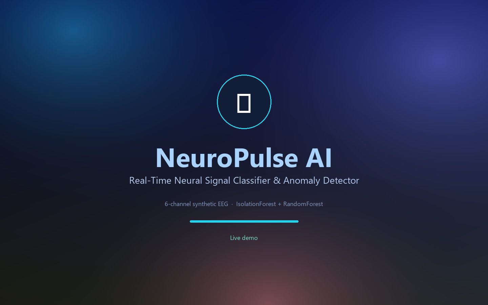
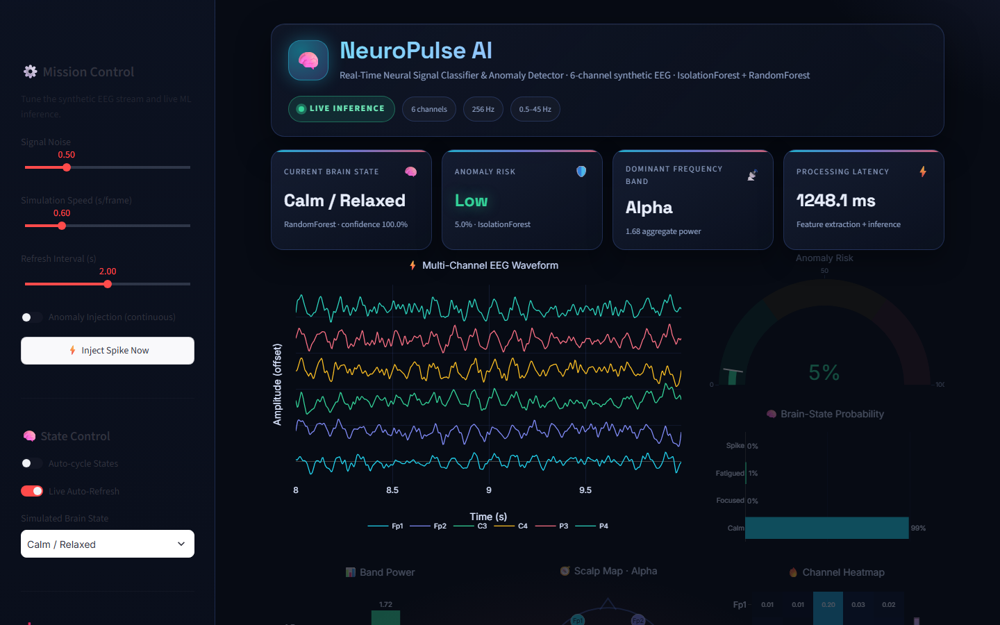
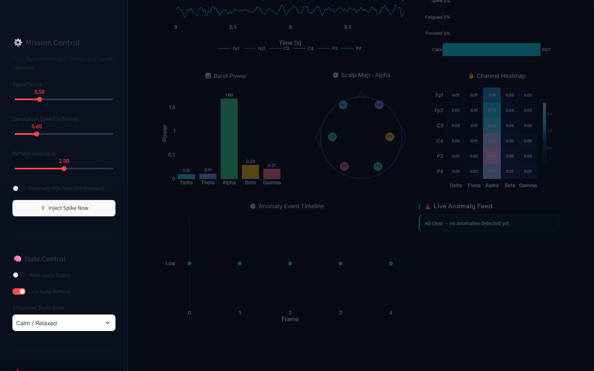
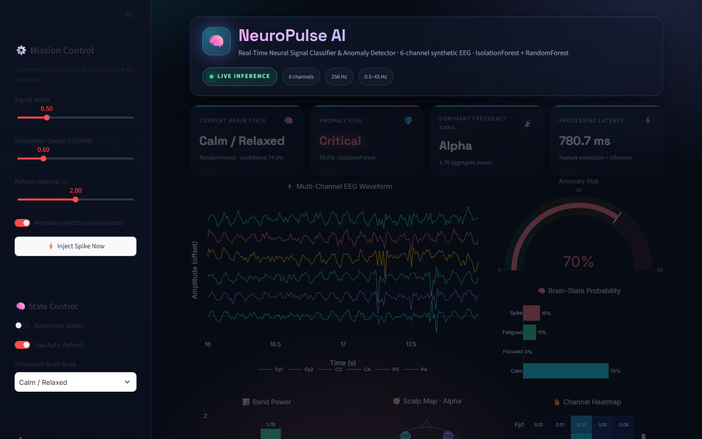
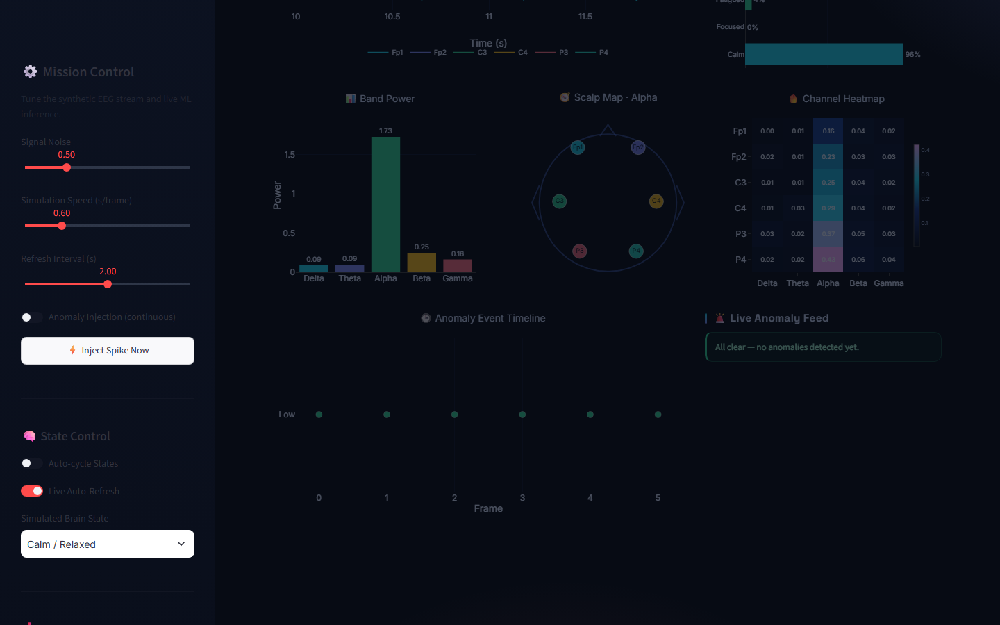

<div align="center">



# 🧠 NeuroPulse AI

**Real-time neural signal classifier & anomaly detector**

A single-file Streamlit dashboard that synthesizes 6-channel EEG, extracts spectral features,
classifies brain state with a RandomForest, and flags abnormal spikes with an IsolationForest — all
rendered in a neon, glassmorphic "mission control" UI.


[Quick start](#-quick-start) · [Screenshots](#-screenshots) · [Demo video](#-demo-video) · [How it works](#-how-it-works)

</div>

---

## ✨ What it does

| | |
|---|---|
| **Synthetic EEG** | 6 channels (Fp1, Fp2, C3, C4, P3, P4) at 256 Hz with per-state spectral profiles, pink noise and optional injected seizure-like spikes. |
| **Signal conditioning** | 5th-order Butterworth bandpass filter, 0.5–45 Hz, applied per channel. |
| **Feature extraction** | Welch PSD → relative Delta / Theta / Alpha / Beta / Gamma power per channel, plus variance, peak-to-peak and RMS. |
| **Anomaly detection** | `IsolationForest` trained on baseline sessions emits a 0–100 % risk score mapped to Low / Medium / Critical. |
| **State classification** | `RandomForestClassifier` predicts Calm / Relaxed, Focused / Active, Fatigued or Abnormal Spike with live class probabilities. |
| **Live dashboard** | Aurora-animated glass UI, KPI cards, multi-channel waveform, risk gauge, band power, scalp topography, channel × band heatmap, event timeline and an alert feed. |
| **Session tooling** | Auto-refresh fragment, noise / speed / refresh sliders, manual spike injection, state auto-cycling and CSV export. |

---

## 📸 Screenshots

### Hero · KPIs, waveform, risk gauge and state probabilities



### Analytics · band power, scalp topography and channel heatmap



### Anomaly detection · IsolationForest flags an abnormal spike



### Timeline · event history and live alert feed



---

## 🎬 Demo video

A 24-second narrated walkthrough of the dashboard is included:

**[▶ `assets/neuropulse_demo.mp4`](assets/neuropulse_demo.mp4)**

It cycles through the title card, live hero view, analytics row, an injected anomaly and the
event timeline with alert feed.

---

## 🚀 Quick start

```bash
git clone <this-repo>
cd neuropulse-ai
pip install -r requirements.txt
streamlit run app.py
```

Then open <http://localhost:8501>.

Or use the helper scripts:

- **Windows:** double-click `run.bat`
- **macOS / Linux:** `bash run.sh`

> Models train on synthetic baseline sessions at first load (a few seconds). No external data,
> no API keys, no GPU required.

---

## 🧩 How it works

```
Synthetic EEG (6 ch, 256 Hz)
        │
        ▼
Butterworth bandpass 0.5–45 Hz
        │
        ▼
Welch PSD → relative band powers + variance / ptp / RMS
        │
        ├──────────────► StandardScaler ──► IsolationForest  ──► anomaly risk %
        │
        └──────────────► StandardScaler ──► RandomForest     ──► brain state + probabilities
                                                     │
                                                     ▼
                                    Streamlit + Plotly dashboard
```

### Brain states

| State | Signature |
|---|---|
| **Calm / Relaxed** | Alpha-dominant (8–12 Hz), low amplitude |
| **Focused / Active** | Beta-dominant (13–30 Hz), higher frequency activity |
| **Fatigued** | Theta/delta-dominant (1–7 Hz), slow rolling waves |
| **Abnormal Spike** | Broadband burst with sharp transient, high variance |

### Project layout

```
neuropulse-ai/
├── app.py                 # Streamlit dashboard (theme, layout, Plotly figures)
├── ml_pipeline.py         # Signal generation, features, models, inference
├── requirements.txt
├── run.bat / run.sh
├── assets/                # Screenshots, cover art, demo video
└── scripts/
    ├── make_demo.py       # Playwright screenshot + screen-recording capture
    └── make_slideshow.py  # Builds the polished MP4 from screenshots
```

### Regenerating demo assets

```bash
streamlit run app.py --server.port 8516
python scripts/make_demo.py        # screenshots + raw capture
python scripts/make_slideshow.py   # final MP4
```

Requires `playwright`, `imageio`, `imageio-ffmpeg` and `python -m playwright install chromium`.

---

## ⚠️ Disclaimer

NeuroPulse AI is a **research / educational demo**. All EEG data is synthetic and the predictions
are not medically meaningful. Do not use it for diagnosis or clinical decision-making.

---

## 📄 License

MIT — see [LICENSE](LICENSE).
